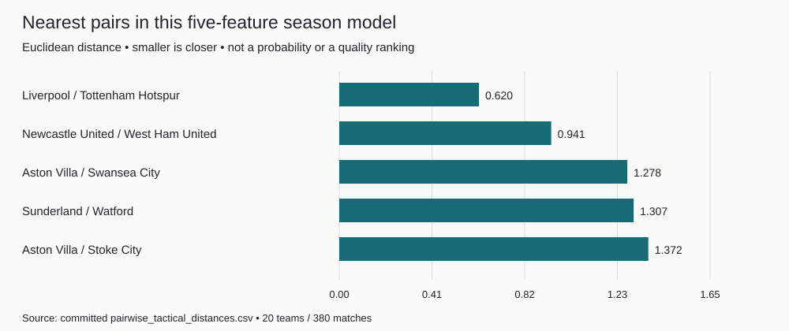

<h1 align="center">Tactical Style Fingerprint</h1>

**Compare football teams through five event-derived tactical measures and inspect the data behind each nearest neighbour.**

[Demo or published artifacts](https://tactical-style-fingerprint.vercel.app)

Premier League 2015/16 only. Python 3.10+ and Node.js 20.9+. Local comparisons need no API key; optional explanations call Featherless.

By Om Patnaik · repository created August 2026.

[](LICENSE)


## Install

| Platform / path | Start here |
| --- | --- |
| Browser | [Open the team comparison](https://tactical-style-fingerprint.vercel.app) |
| Backend | `pip install -r requirements.txt` in a virtual environment |
| Frontend | `npm --prefix frontend ci` |

Start `uvicorn backend.app.main:app --reload --port 8000`, then `npm --prefix frontend run dev` in another terminal. Open http://localhost:3000. Committed processed data lets you compare teams without downloading raw matches or enabling LLM explanations.

```bash
uvicorn backend.app.main:app --reload --port 8000
# In another terminal:
npm --prefix frontend run dev
```

## Why

You want to compare how teams play without turning league position or one tactical label into the answer. This model standardizes five event-derived features and ranks Euclidean distances. Event data cannot observe full-team shape, defensive lines, or off-ball movement.

## Results



Liverpool and Tottenham Hotspur are the nearest pair at distance 0.620 in the 20-team model. Distance is not a probability or a percentage of tactical identity.

Rebuild with `python scripts/plot_readme_distances.py`. [Processed numeric inputs](data/processed/) · [Model definitions](README-DETAILS.md#the-five-dimensions).

## Inspect a comparison

Features cover attacking territory, pass verticality, pressing intensity, attacking width, and counterattacking tendency. Rankings use population z-scores with equal weights; the 0–100 radar scale is display-only.

## Read an optional explanation

Configure a server-side Featherless key/model to explain already-calculated evidence. A failed provider request does not stop comparisons; grounded prompting still cannot guarantee correct prose. Feature correlation and narrow raw ranges limit ranking stability.

## Notes from building it

I began with inspectable event definitions before aggregating the season. Keeping similarity deterministic prevents a language model from inventing the nearest team. I would test feature sensitivity and additional seasons before presenting the five dimensions as a general tactical model.

## Commands

```bash
uvicorn backend.app.main:app --reload --port 8000  # start data/API service
npm --prefix frontend run dev                    # start the interface
python analysis/build_raw_fingerprints.py         # rebuild from season aggregates
python analysis/calculate_tactical_similarity.py  # rebuild distances
python scripts/plot_readme_distances.py           # plot committed distances
```

## Verify it yourself

```bash
python -m pytest -q
npm --prefix frontend run lint
npm --prefix frontend run build
```

Backend tests cover API data, explanation grounding, rate limits, and failure handling. Frontend checks cover lint/build; manual interaction and provider behaviour are separate. Full raw-data reconstruction is documented in the guide and needs the StatsBomb cache.

## Credits, license and pointers

Data: [StatsBomb Open Data](https://github.com/hudl/open-data), under its own terms. Built with pandas, FastAPI, Next.js/React, and optional Featherless/Qwen explanations; see dependency manifests. Project code: [MIT](LICENSE).

[Full setup, original notes, and project history](README-DETAILS.md).
